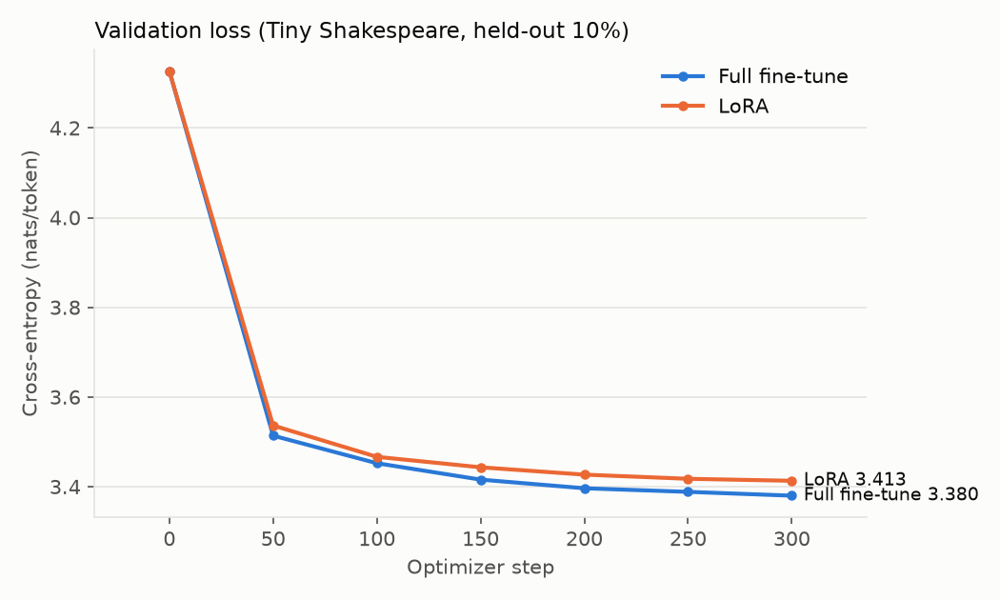

# GPT-2 from NumPy to PyTorch, with LoRA

The original [gpt_numpy.py](gpt_numpy.py) and notebooks `00`–`06` teach GPT-2 small layer by layer, including handwritten backward passes. They remain intact. `gpt_torch.py` ports the same architecture to PyTorch; `lora.py` implements adapters; `benchmark.py` runs paired training experiments.

## Architecture and numerical port

The NumPy model has learned token and positional embeddings, pre-layer normalization transformer blocks, masked multi-head causal attention, a fourfold MLP with tanh-approximate GELU, and a final layer normalization. The output head uses the token embedding matrix transposed, so its parameters are tied. Defaults are GPT-2 small: vocabulary 50,257; context 1,024; 12 layers; 12 heads; width 768. Every linear weight is initialized from N(0, 0.02²), except residual projections, whose standard deviation is `0.02/sqrt(2*n_layer)`. Biases start at zero; layer normalization gains start at one and use epsilon 1e-5.

NumPy stores linear weights `(in, out)` and computes `x @ W`; PyTorch `nn.Linear` stores `(out, in)`. `copy_from_numpy` transposes these weights. PyTorch uses `nn.LayerNorm`, `torch.softmax`, and `F.gelu(..., approximate='tanh')`. Floating point reduction order and the backend GELU implementation can produce small numerical differences. The port uses an explicit causal mask and does not use flash attention, to make the attention math inspectable.

`tests/test_torch_port.py` compares model logits, attention output, cross entropy, and the gradient of every parameter (weights, biases, LayerNorm gains and shifts, embeddings) on identical float64 weights and tokens. It also checks causality. `tests/test_pretrained.py` loads the real GPT-2 small checkpoint with `load_pretrained_gpt2` and compares its logits with HuggingFace `GPT2LMHeadModel` (it is skipped until the weights are in the local HuggingFace cache; `python benchmark.py` downloads them). These tests are a required gate before interpreting LoRA results.

## LoRA

For a PyTorch linear weight `W₀` of shape `(out, in)`, LoRA computes

`y = x W₀ᵀ + b + (α/r) dropout(x) Aᵀ Bᵀ`, where `A` is `(r, in)` and `B` is `(out, r)`.

The base model is frozen. `A` uses Kaiming uniform initialization and `B` starts at zero, so inserting adapters preserves the initial output exactly when dropout is disabled (and also while `B` is zero). At the first step, `B` receives a gradient while `A` normally receives zero gradient; `A` becomes trainable after `B` moves away from zero. Targets default to each block's fused QKV attention projection, attention output projection, MLP input projection, and MLP output projection. Biases and embeddings stay frozen. Merging adds `(α/r) BA` to the base weight. Do not merge repeatedly or continue adapter training after merge. Adapter files contain only target configurations and adapter tensors; the original base checkpoint is still needed for loading.

`tests/test_lora.py` checks shapes, freezing, initialization, gradients, adapter persistence, and merged outputs. `tests/test_peft.py` wraps an identical PyTorch GPT with PEFT's `LoraModel`, copies `A` and `B` directly into PEFT's adapters, and compares trainable-parameter counts, outputs, losses, gradients, one SGD update, and merged outputs. The reference uses PEFT's ordinary `nn.Linear` convention, rank/alpha/dropout, four targets, and `bias='none'`. A passing test, rather than code inspection alone, is necessary to claim numerical agreement.

## Install and test

```bash
python -m pip install -r requirements-lora.txt
python -m pytest -rs tests      # expect 5 passed, 0 skipped (4 passed, 1 skipped before the GPT-2 weights are cached)
```

PyTorch and PEFT are optional to the original NumPy notebooks; the separate requirements file avoids changing their dependencies. Every test module uses `pytest.importorskip`, so a run where every test is skipped also exits 0. Check the summary for `0 skipped`, using `-rs` to list skip reasons.

**WSL2 note.** If a native Linux NVIDIA driver is installed inside WSL (it shows up as `/lib/x86_64-linux-gnu/libcuda.so.<version>`), PyTorch segfaults on CUDA initialization. Autograd initializes CUDA, so this happens even for CPU-only `backward()`. The WSL driver loads the native driver's `libnvidia-ptxjitcompiler`, and the two versions don't match. On this machine they come from Ubuntu's `libnvidia-compute-580` package. The proper fix is `sudo apt remove libnvidia-compute-580`, but check apt's prompt first, because packages that depend on it, such as `nvidia-cuda-toolkit`, may be removed too. Until then, put the Windows driver directory first on the library path:

```bash
export LD_LIBRARY_PATH="/usr/lib/wsl/lib:$(dirname "$(ls -t /usr/lib/wsl/drivers/*/libcuda.so.1.1 | head -1)")"
```

## Benchmark: LoRA vs full fine-tuning on Tiny Shakespeare

```bash
python benchmark.py             # ~4 min on an RTX 3050 Ti Laptop GPU; writes results/shakespeare_gpt2/
```

Both arms start from **pretrained GPT-2 small (124M)** (`openai-community/gpt2` safetensors, loaded with `gpt_torch.load_pretrained_gpt2`) and fine-tune on [Tiny Shakespeare](https://raw.githubusercontent.com/karpathy/char-rnn/master/data/tinyshakespeare/input.txt), tokenized with GPT-2 BPE (tiktoken):

- **Data:** 304,222 training tokens and 33,803 validation tokens, from a contiguous 90/10 split.
- **Fixed settings:** both arms train on the same seeded random windows, with batch 4 × 256 tokens, 300 AdamW steps, weight decay 0.01, gradient clipping at 1.0, and a 20-step linear warmup to a constant learning rate.
- **Learning rates:** 3e-5 for full fine-tuning and 1e-3 for LoRA. LoRA usually needs a much larger LR, so a shared LR would handicap one arm. These are conventional values, not tuned.
- **LoRA config:** rank 8, alpha 16, dropout 0, on `attn.c_attn`, `attn.c_proj`, `mlp.c_fc` and `mlp.c_proj` in all 12 blocks.
- **Process isolation:** each arm runs in its own process, so CUDA caches and peak-memory counters are not shared between arms.
- **Determinism:** runs use `torch.use_deterministic_algorithms(True)`.

Metric definitions:

- **Time/step:** a synchronized forward, backward, gradient clip and optimizer step. It excludes evaluation and the first 10 steps, and reports the median with the p10–p90 range.
- **Peak memory:** `torch.cuda.max_memory_allocated`. The counter is reset after the model is loaded, so the resident weights are included, and it covers training and periodic evaluation.
- **Validation loss:** mean token cross-entropy over all 132 non-overlapping 256-token windows of the held-out split, measured at step 0 and every 50 steps.

### Results

| Metric | Full fine-tune | LoRA (r=8) |
|---|---:|---:|
| Trainable parameters | 124,439,808 (100%) | 1,179,648 (0.94%) |
| Peak GPU memory allocated | 2,746 MiB | 1,800 MiB (−34%) |
| Peak GPU memory reserved | 3,076 MiB | 1,926 MiB |
| Time/step, median [p10–p90] | 328 ms [324–331] | 222 ms [221–223] (−32%) |
| Validation loss, step 0 (pretrained) | 4.3267 | 4.3267 |
| Validation loss, step 300 | **3.3799** | 3.4131 |
| Validation perplexity, step 300 | 29.37 | 30.36 |

Hardware: NVIDIA GeForce RTX 3050 Ti Laptop GPU (4 GB), Windows driver 610.47 under WSL2, AMD Ryzen 5 5600H, 6.7 GiB RAM visible to WSL; PyTorch 2.15.0+cu132, PEFT 0.21.2, Python 3.12.3. The full record, per-step losses and timings are in [`results/shakespeare_gpt2/`](results/shakespeare_gpt2/): `results.json`, `full.json`, `lora.json`, `comparison.md`, `validation_loss.png` and `train_loss.png`.



On this run:

- LoRA trains under 1% of the parameters.
- LoRA uses about a third less peak GPU memory, mostly because AdamW state and gradients exist only for the adapters.
- LoRA is about a third faster per step, because no weight gradients are computed for the frozen base. The frozen base still runs in both the forward and backward passes.
- Full fine-tuning reaches a validation loss 0.033 nats/token lower after 300 steps.

The batch size was chosen so that full fine-tuning fits in the 4 GB of VRAM. At batch 8 × 256, the WSL driver silently spills into shared system memory instead of raising an out-of-memory error, and steps become about 5× slower. That would corrupt the timing comparison.

## Scope and limitations

- **Single run.** This is one seed and one short run of 300 steps (about 0.3M tokens, roughly one epoch). The quality gap between the arms is not a confidence interval, and it may change with longer training, tuned learning rates, a different rank, or other target modules.
- **Memory headroom.** LoRA's memory saving would grow with batch size, but the full fine-tuning arm leaves too little VRAM on this GPU to test larger batches.
- **Small speed-up.** LoRA does not remove the frozen model's forward and backward passes, so its speed-up is modest compared with its parameter reduction.
- **Hardware dependence.** Timings come from a laptop GPU under WSL2 and will differ on other hardware.
- **Narrow task.** Tiny Shakespeare is a small, stylistically narrow corpus. The result is not a general claim about downstream fine-tuning.
