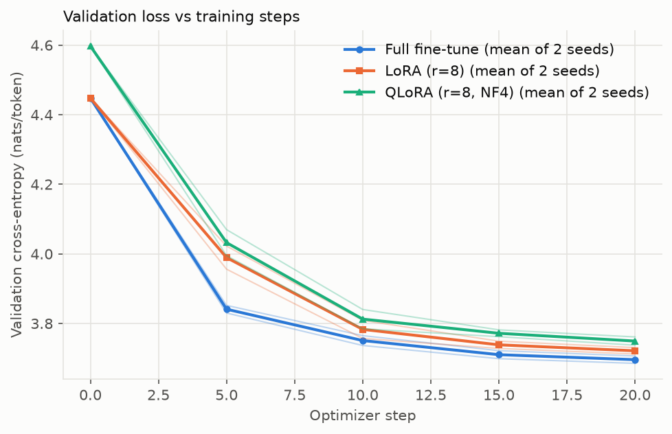
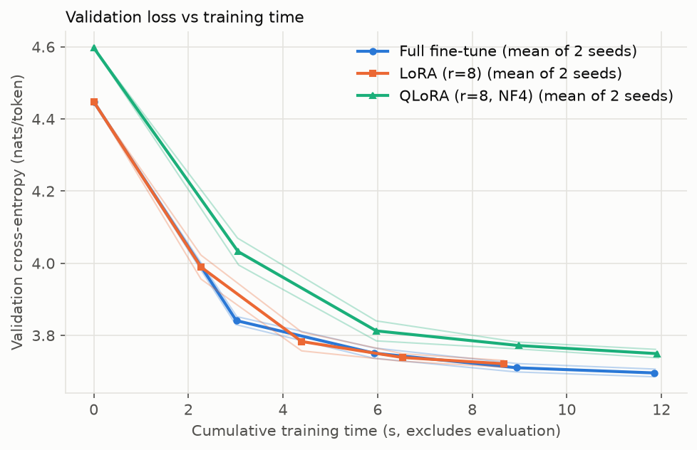
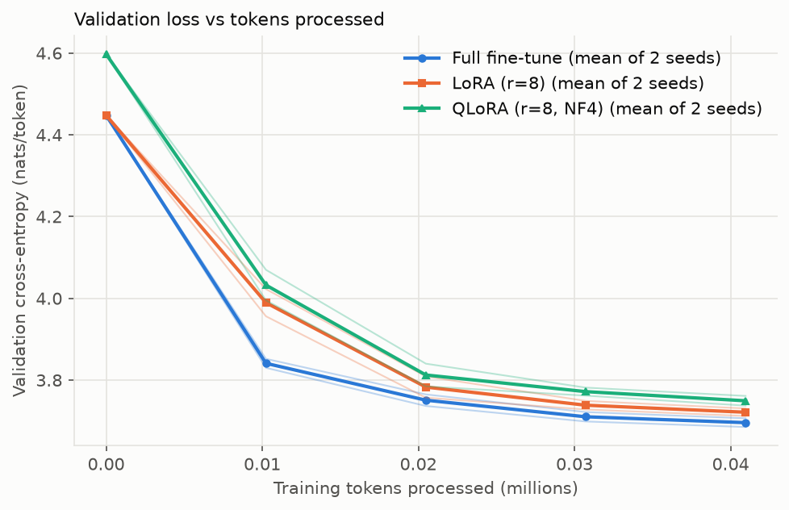
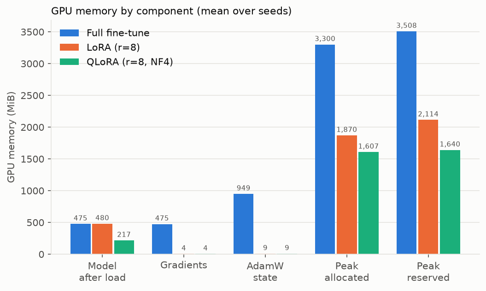
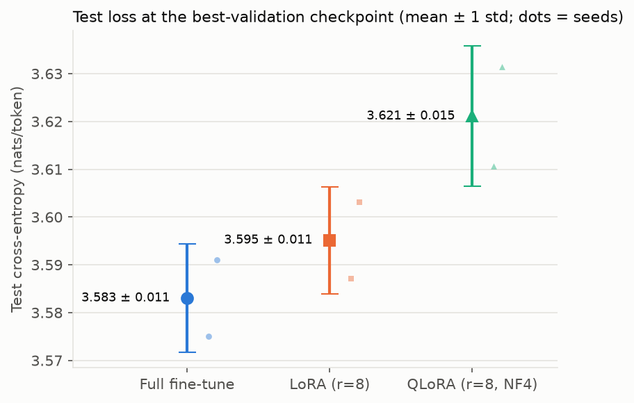
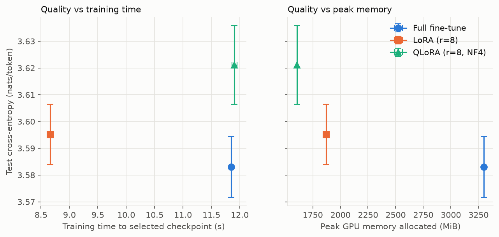

# Benchmark report: full fine-tuning vs LoRA vs QLoRA on GPT-2 small

> **SMOKE TEST — NOT BENCHMARK RESULTS.** These numbers come from a deliberately tiny run (20 steps, 2 seeds, 2 learning rates per method). It checks that the pipeline works end to end; it says nothing about which method is better. Run `python benchmark.py all` for the real benchmark.

## Experimental setup

- **Model:** pretrained GPT-2 small (124M), huggingface.co/openai-community/gpt2 model.safetensors; fp32 compute for every method.
- **Data:** Tiny Shakespeare (1,115,394 characters, sha256 `86c4e6aa9db7…`), raw text cut into contiguous 80/10/10 sections at blank lines, each section tokenized separately with the GPT-2 BPE. Training windows are sampled inside the training section only, so none crosses a split boundary.

| Split | Characters | Tokens |
|---|---:|---:|
| train | 892,487 | 267,738 |
| validation | 111,370 | 34,229 |
| test | 111,537 | 36,056 |

- **Training (identical for every method):** 20 optimizer steps, effective batch 8 × 256 tokens (4 per micro-batch, gradient accumulation), 0.04M training tokens (≈0.2 passes over the training split); AdamW, weight decay 0.01, gradient clipping 1.0, 5-step linear warmup then cosine decay to 0.1 × peak LR; validation every 5 steps on all non-overlapping 256-token windows of the validation split. Training-window positions depend only on the seed, so every method sees the same batches in the same order for a given seed.
- **LoRA / QLoRA:** rank 8, alpha 16.0, no dropout, on attn.c_attn, attn.c_proj, mlp.c_fc and mlp.c_proj of all 12 blocks. QLoRA stores those frozen projection weights as NF4 (block 64, fp32 absmax, no double quantization) and dequantizes them on the fly; everything else is as in LoRA.
- **Learning-rate search:** 2 candidates per method, full fine-tuning [3e-05, 0.0001], LoRA and QLoRA [0.001, 0.003] (each tuned separately), one run per candidate with tuning seed 0 and the same schedule as the final runs. The LR whose best checkpoint has the lowest validation loss is selected. The test split is not loaded during tuning or training.
- **Final runs:** seeds [42, 123] (disjoint from the tuning seed) with the selected LR. For each run the checkpoint with the lowest validation loss is kept, reloaded (its validation loss is re-measured and must match), and only then evaluated on the test split.
- **Measurement:** training time is the sum of per-step times bracketed by `torch.cuda.synchronize()` (evaluation and checkpoint I/O excluded); time/step medians skip the first 3 steps. Peak memory is the maximum over training steps of `torch.cuda.max_memory_allocated/reserved()`, reset before each step. Gradient and optimizer memory are the byte sizes of those tensors; "activations and other" is the peak minus model, gradients and optimizer state. Each run is its own process.
- **Reproducibility:** Deterministic mode makes reruns on the same machine and software repeatable in practice; it is not a guarantee of bitwise-identical results across GPUs, drivers or library versions. Deterministic algorithms: True.
- **Hardware/software:** NVIDIA GeForce RTX 3050 Ti Laptop GPU (4096 MiB), driver 610.47, AMD Ryzen 5 5600H with Radeon Graphics, WSL2; PyTorch 2.14.1+cu126 (CUDA 12.6), Python 3.12.3.

## Hyperparameter selection (validation loss, tuning seed)

| Method | Learning rate | Best validation loss | At step | Selected |
|---|---:|---:|---:|:---:|
| Full fine-tune | 3e-05 | 3.7630 | 20 |  |
| Full fine-tune | 0.0001 | 3.6869 | 20 | ✓ |
| LoRA (r=8) | 0.001 | 3.7728 | 20 |  |
| LoRA (r=8) | 0.003 | 3.7055 | 20 | ✓ |
| QLoRA (r=8, NF4) | 0.001 | 3.8075 | 20 |  |
| QLoRA (r=8, NF4) | 0.003 | 3.7406 | 20 | ✓ |

**Selected learning rate at the edge of its grid:** Full fine-tune (0.0001), LoRA (r=8) (0.003), QLoRA (r=8, NF4) (0.003). The optimum may lie outside the searched range; widen the grid for that method before drawing conclusions.

## Results (mean ± sample std over seeds)

n = Full fine-tune: 2, LoRA (r=8): 2, QLoRA (r=8, NF4): 2

| Metric | Full fine-tune | LoRA (r=8) | QLoRA (r=8, NF4) |
|---|---:|---:|---:|
| Test loss (nats/token) | 3.583 ± 0.011 | 3.595 ± 0.011 | 3.621 ± 0.015 |
| Test perplexity | 35.98 ± 0.41 | 36.42 ± 0.41 | 37.38 ± 0.55 |
| Best validation loss | 3.696 ± 0.015 | 3.721 ± 0.013 | 3.749 ± 0.017 |
| Validation loss before training | 4.448 ± 0.000 | 4.448 ± 0.000 | 4.597 ± 0.000 |
| Selected checkpoint step | 20 ± 0 | 20 ± 0 | 20 ± 0 |
| Total training time (s) | 12 ± 0 | 9 ± 0 | 12 ± 0 |
| Training time to selected checkpoint (s) | 12 ± 0 | 9 ± 0 | 12 ± 0 |
| Time per step, median (ms) | 583 ± 0 | 427 ± 0 | 583 ± 1 |
| Trainable parameters | 124,439,808 ± 0 | 1,179,648 ± 0 | 1,179,648 ± 0 |
| Model memory after load (MiB) | 475 ± 0 | 480 ± 0 | 217 ± 0 |
| Gradient memory (MiB) | 475 ± 0 | 4 ± 0 | 4 ± 0 |
| AdamW state memory (MiB) | 949 ± 0 | 9 ± 0 | 9 ± 0 |
| Activations and other at peak (MiB) | 1,400 ± 0 | 1,376 ± 0 | 1,376 ± 0 |
| Peak GPU memory allocated (MiB) | 3,300 ± 0 | 1,870 ± 0 | 1,607 ± 0 |
| Peak GPU memory reserved (MiB) | 3,508 ± 0 | 2,114 ± 0 | 1,640 ± 0 |

Per-seed values: `final_runs.csv`; per-evaluation curves: `runs/final/<method>/seed<seed>/history.csv`; per-step logs: `steps.csv`.

**Memory note:** for Full fine-tune, peak reserved memory exceeded the GPU memory that was free when the run started (other processes, e.g. the desktop, hold some VRAM). Runs that exceed the GPU's total memory are rejected as out-of-memory, but a partial spill below that limit cannot be ruled out; compare its time per step across seeds for outliers.

## Figures

## Quality vs training time and memory

- **LoRA (r=8) vs full fine-tuning:** test loss +0.012 nats (larger than seed-to-seed std); training time to the selected checkpoint ×0.73, time per step ×0.73; peak allocated memory ×0.57 (-1,430 MiB).
- **QLoRA (r=8, NF4) vs full fine-tuning:** test loss +0.038 nats (larger than seed-to-seed std); training time to the selected checkpoint ×1.01, time per step ×1.00; peak allocated memory ×0.49 (-1,693 MiB).

## Which method gives the best trade-off on a 4 GB GPU?

Not answerable from this smoke test: the runs are far too short and too few to compare quality. The measured memory and per-step time above are real but only illustrate the pipeline.

## Limitations and possible confounds

- 2 seeds per method and one learning-rate grid of 2 points; the selected LR may sit at a grid edge (check the table above). Only the learning rate was tuned (rank, alpha, weight decay, schedule were fixed).
- Learning rates differ between methods by design (each method is tuned on its own grid).
- Weight decay applies to every trainable tensor: for full fine-tuning that includes embeddings, LayerNorms and biases; for LoRA/QLoRA only the adapter matrices.
- QLoRA starts from a higher validation loss because NF4 quantization perturbs the frozen weights.
- QLoRA dequantizes with ordinary PyTorch ops in every forward and backward pass (no fused kernels like bitsandbytes), so its per-step time is an upper bound for an optimized implementation.
- Gradient accumulation keeps full-precision gradients alive across micro-batches, which raises full fine-tuning's peak memory relative to a single large batch; the micro-batch size is limited by fitting full fine-tuning into 4 GB, so larger batches (where adapter savings grow) were not measured.
- Deterministic algorithms are on for every method. Their cost is not re-measured by this run; one 30-step check on an RTX 3050 Ti Laptop GPU found 1.6–3.6% per step (full 1.8%, LoRA 1.6%, QLoRA 3.6%).
- One laptop GPU under WSL2; timings depend on clocks, thermals and other GPU load.
- The test split is the last 10% of the text (mostly later plays), so it differs in content from training.
